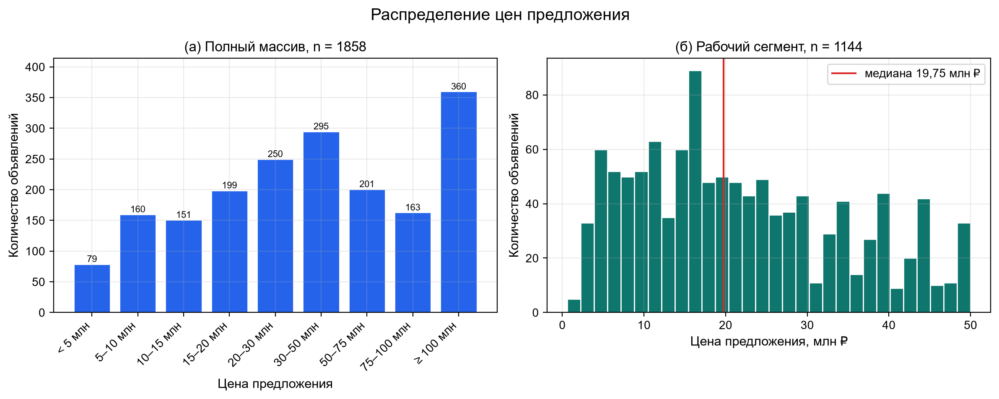
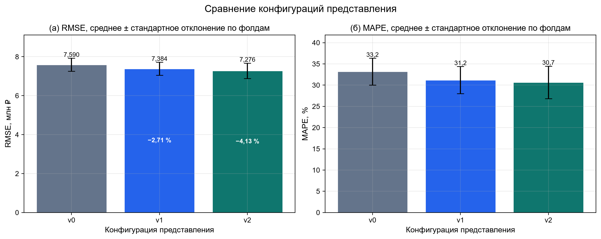
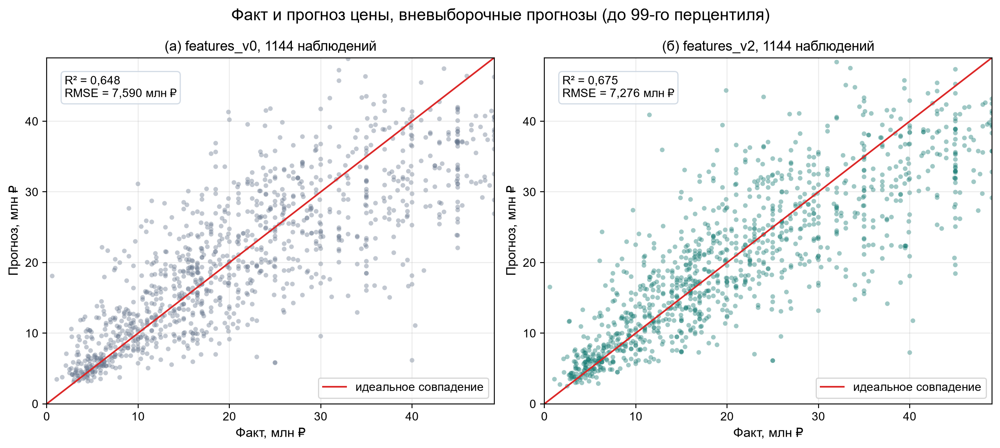
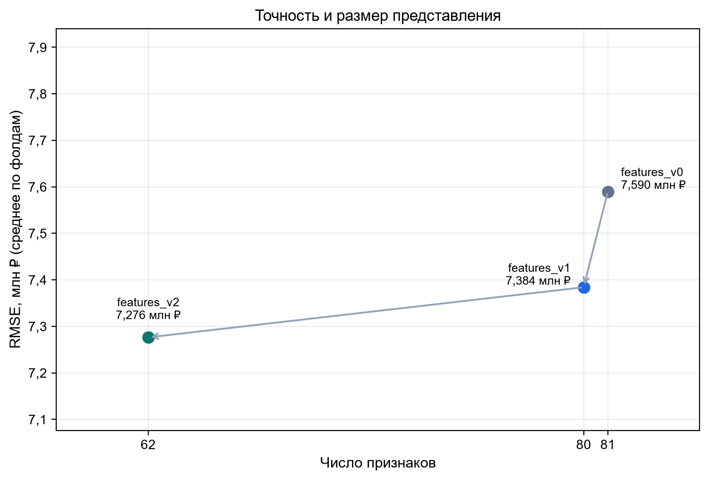
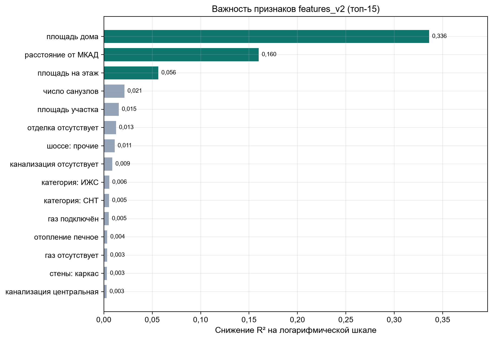
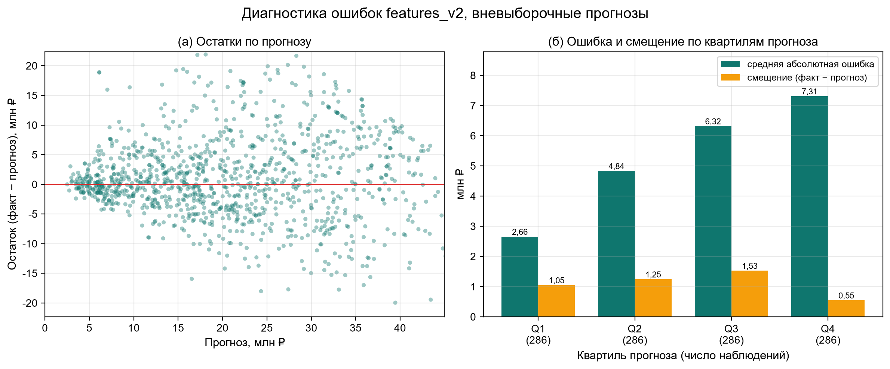
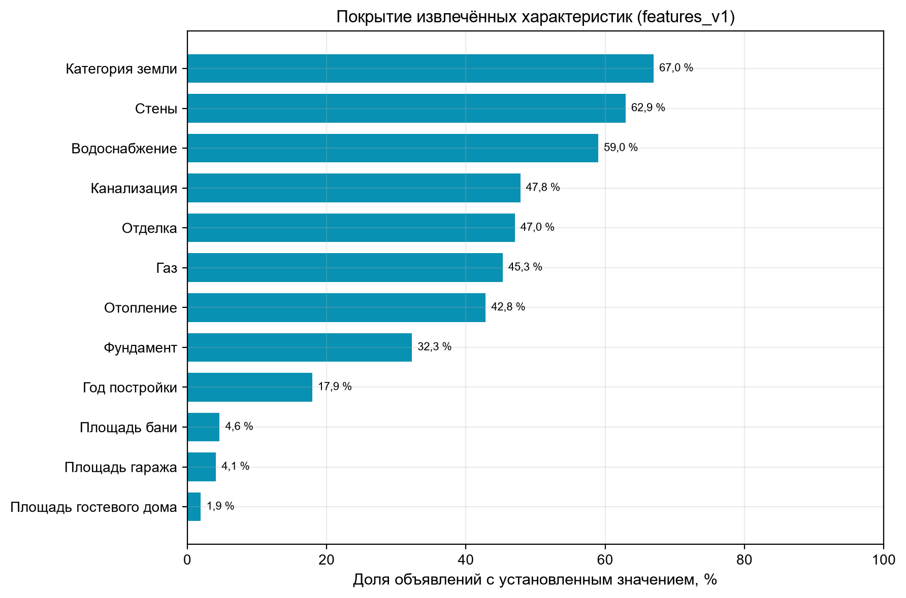

Алгоритм итеративного конструирования признаков с использованием больших языковых моделей для прогнозирования цен предложения индивидуальных жилых домов
1. Введение
Прогнозирование цен предложения жилья опирается одновременно на структурированные поля карточки объявления и на свободный текст описания. Перенос сведений из текста в матрицу признаков с помощью большой языковой модели (LLM) технически доступен, но не гарантирует улучшения прогноза: извлечённое значение может дублировать имеющееся поле, покрывать лишь часть объектов или смешивать фактическое состояние объекта с намерением продавца. Качество извлечения определяется поэтому не фактом обращения к модели, а устройством запроса и правилами объединения источников.
Работа исследует, насколько качество промпта — состав запрашиваемых характеристик, схема ответа, словарь уровней и правила согласования с карточкой — определяет ошибку прогноза. Эксперимент поставлен на одном массиве объявлений «Домклик» (1858 наблюдений; рабочий сегмент — цены не выше 50 млн руб.). Регрессия выполняется одной моделью (градиентный бустинг) при одной схеме групповой кросс-валидации; изменяется только представление объекта, которое строится последовательно: программная обработка карточки без LLM, извлечение по общему промпту и извлечение по двум специализированным промптам.
Вклад работы состоит в следующем.
1. Описан воспроизводимый контур построения признаков с участием LLM: модель извлекает атрибуты из неструктурированного текста по версионируемому промпту, а правила объединения и преобразования вынесены в код. Семантическое извлечение и детерминированное преобразование разделены, ответы кэшируются по хешу текста и промпта, поэтому смена промпта воспроизводимо инвалидирует только извлечения. Контур оформлен как итеративный алгоритм (п. 2.2), в котором изменение промпта или правил принимается по измеренному эффекту при неизменных регрессоре и схеме валидации.
2. Определены требования к промпту извлечения, обеспечивающие пригодность ответа для матрицы признаков: строгая схема JSON с фиксированными каноническими уровнями, запрет значений без дословного подтверждения, различение указанного, запланированного и возможного состояния, трактовка описания как данных (защита от инструкций внутри текста). Показано, что переход от одного общего промпта к двум специализированным (отдельно для категориальных и числовых характеристик) снижает ошибку и число признаков одновременно.
3. Получена количественная оценка вклада промптов при неизменном регрессоре и групповой валидации: извлечение по промпту снижает RMSE на 2,71 % относительно программной базы, а переход к специализированным промптам — ещё на 1,46 % при сокращении числа признаков с 80 до 62.
1.1 Обзор существующих работ
Ближайший методический аналог — CAAFE, где LLM генерирует преобразования признаков, а их полезность проверяется обучением модели [1]. В CAAFE преобразования строятся из одного табличного источника; качество запроса на извлечение и согласование двух источников там не рассматриваются. Работы по классификации дерматоскопических изображений [2], информационные системы поддержки пространственного развития [3] и систематизация специальных письменностей [4] относятся к другим предметным задачам и служат контекстом постановки, а не методом прогнозирования цен. Чат-бот с графами знаний [5] использует текст иначе — для формирования ответа, а не для построения матрицы признаков.
ProTeGi [6] и OPRO [7] оптимизируют промпт по результатам оценивания; в настоящей работе промпт меняется однократно (переход v1 → v2 по составу запросов), а стратегия управления поиском не оценивается. Исследование структурно-функциональной устойчивости [8] решает графовую задачу, не переносимую непосредственно на конструирование признаков регрессии. LLAMBO [9] применяет LLM в байесовской оптимизации, AutoML-Agent [10] — к организации процесса разработки в целом; эти работы обосновывают обратную связь между этапами, но не дают оценки вклада отдельных изменений представления.
Работа по аварийным изменениям энергопотребления [11] обращает внимание на то, что экстремальное наблюдение может отражать содержательное состояние системы; в объявлениях нетипичная цена также требует проверки, а не автоматического признания ошибкой. При интерпретации учитывается риск адаптивного переобучения вследствие повторного использования валидации [12].
Проверяются три гипотезы. H1: извлечение характеристик из описания по промпту снижает ошибку относительно программной обработки карточки при одном регрессоре и групповой валидации. H2: компактное представление с меньшим числом признаков не уступает широкой базе. H3: переход к специализированным промптам снижает ошибку и число признаков относительно общего промпта.
2. Методика исследования

2.1. Постановка задачи и протокол оценки
Массив образуют 1858 объявлений о продаже индивидуальных жилых домов. Наблюдение описывается вектором структурированных полей карточки x_i, текстовым описанием d_i и ценой предложения y_i в рублях. Цена предложения не отождествляется с фактической ценой сделки; основные эксперименты ограничены сегментом y_i≤50 млн руб.
Представление объекта на итерации t имеет вид
u_i=Φ_S^((t)) (x_i,E_(p_t ) (d_i,x_i^ctx )),
где E_(p_t ) — извлечение атрибутов языковой моделью с промптом p_t, x_i^ctx — структурированный контекст, передаваемый модели, Φ_S^((t)) — правила объединения и преобразования, реализованные кодом. Разделение E и Φ позволяет повторно использовать неизменённые извлечения при изменении правил и не смешивать ошибку модели с ошибкой преобразования.
Все конфигурации обучаются одной моделью — HistGradientBoostingRegressor без подбора гиперпараметров (не более 400 итераций, ранняя остановка после 20 итераций без улучшения, доля внутренней выборки ранней остановки 0,1). Пропуски сохраняются как NaN и обрабатываются моделью. Целевая переменная моделируется в виде t_i=ln(1+y_i ); прогноз возвращается в рубли преобразованием expm1 и ограничивается диапазоном цен обучающей части блока.
Качество оценивается пятиблочной групповой кросс-валидацией (GroupKFold по населённым пунктам): объявления одного населённого пункта не попадают одновременно в обучение и контроль. Основной показатель — средняя по блокам RMSE в рублях:
L_val (c)=1/K ∑_(k=1)^K▒√(1/|V_k |  ∑_(i∈V_k)^▒(y_i-y ̂_i^((k,c) ) )^2 ), K=5.
Дополнительно рассчитываются MAE, MAPE и R².

2.2. Алгоритм итеративного улучшения набора признаков

Цикл связывает три величины: представление (набор признаков S и правила преобразования Φ_S), промпт извлечения p и валидационную ошибку L_val. Начальное состояние строится без языковой модели, а каждый следующий проход изменяет промпт или правила преобразования и принимается по измеренному эффекту, а не по правдоподобию предложения. Один проход описан в алгоритме 1, число проходов ограничено бюджетом экспериментов.

Алгоритм 1 – Итеративное улучшение набора признаков с участием LLM
1. Построить базовое представление S_0 по структурированным полям карточки: числовые поля, производные отношения и логарифмы, индикаторы пропусков и текстовые флаги, вычисляемые правилами. Обращений к языковой модели на этом шаге нет.
2. Обучить регрессор на текущем представлении, получить вневыборочные прогнозы y ̂_i^((k,c)) по пятиблочной групповой кросс-валидации, вычислить L_val и зарегистрировать запуск вместе с хешем матрицы, составом признаков и параметрами.
3. Собрать диагностический отчёт: ошибку и смещение по квартилям прогноза, перестановочную важность признаков, покрытие полей, расхождения карточки и извлечений, наблюдения с наибольшей относительной ошибкой.
4. Запросить у языковой модели ограниченный набор проверяемых гипотез об изменении представления: добавить признак; удалить или объединить дублирующие и редкие признаки; уточнить промпт (состав запрашиваемых характеристик, словарь уровней, единицы измерения, статусы); изменить правила согласования источников. Гипотеза принимается к реализации вместе с указанием, какое поле или правило она затрагивает и по какой метрике будет измерен её эффект.
5. Реализовать гипотезы: выпустить новую версию промпта p_(t+1) и (или) новую версию правил Φ_S^((t+1)). Промпт входит в ключ кэша, поэтому его смена инвалидирует только извлечения, а незатронутые ответы берутся из кэша по хешу текста.
6. Обучить модель на новом представлении тем же регрессором и при той же схеме валидации и сопоставить L_val с предыдущим проходом.
7. Принять изменение, если ошибка уменьшилась, либо если она не выросла при сокращении числа признаков, и вернуться к шагу 3. Остановиться, если очередной набор гипотез не даёт улучшения, если его величина не превышает разброса между блоками или если исчерпан бюджет проходов.

Цикл подчинён трём ограничениям. Цена не передаётся ни в промпт извлечения, ни в правила преобразования: обратная связь идёт только через диагностику остатков уже полученных прогнозов, поэтому признаки не настраиваются по контрольным значениям. Схема валидации не меняется между проходами, а зависящие от выборки пороги определяются внутри обучающего блока — иначе сравнение проходов смешивает эффект изменения с эффектом доступа к контрольным объектам. Наконец, соблюдение схемы ответа не подтверждает семантическую правильность извлечения: расхождения карточки и текста остаются предметом ручной проверки, а не автоматического решения цикла.
В выполненной серии цикл прошёл начальное состояние и два прохода: переход v0 → v1 добавил характеристики, извлечённые из описания по единому промпту, переход v1 → v2 разделил запрос на категориальный и числовой и сократил состав признаков. Каждому состоянию соответствует строка таблицы 2, состав состояний описан в п. 2.3. Оценка самого механизма поиска — числа проходов до улучшения и устойчивости выбора гипотез — в работу не входит: решение о принятии изменения опирается на ту же валидационную схему, что создаёт риск адаптивного переобучения [12].

2.3. Конфигурации представления
Серия из трёх конфигураций воспроизводит переход от программной обработки карточки к извлечению характеристик из текста и последующему уточнению промпта.
features_v0 (81 признак) строится без LLM: числовые поля карточки, производные отношения и логарифмы, индикаторы пропусков, метки продавца и текстовые флаги, получаемые правилами. База, таким образом, уже включает простую обработку описания.
features_v1 (80 признаков) дополняет числовой каркас (площадь дома и участка, этажность, расстояние от МКАД, направление шоссе) характеристиками отделки, стен, фундамента, коммуникаций, планировки и возраста дома, которые извлекает языковая модель по единому промпту prompt_v1.txt со строгой схемой ответа в формате JSON. Промпт различает статусы stated, planned и possible; в матрицу входят только значения со статусом stated, что отделяет фактическое состояние от намерения или возможности. При заполнении каркаса приоритет имеет карточка, а текст восстанавливает пропуски.
features_v2 (62 признака) переходит к двум специализированным промптам: prompt_v2_cat.txt запрашивает категориальные признаки по фиксированному словарю уровней, prompt_v2_num.txt — числовые (площади, этажность, расстояние, год постройки, планировка, дополнительные строения). Ответы кэшируются вместе с хешем текста и хешем промптов, а наличие ответа отделено от наличия содержательного значения: уровень unknown не трактуется как восстановленная характеристика.

2.4. Проектирование промптов и согласование источников
Промпт рассматривается как часть метода, а не как техническая деталь. К нему предъявляются требования, без которых ответ непригоден для матрицы признаков: строгая схема ответа, фиксированный набор уровней для каждой категориальной характеристики, обязательное дословное подтверждение для каждого значения, различение указанного, запланированного и возможного состояния (газ по границе не отождествляется с подключённым газом), запрет на догадки при отсутствии сведений и трактовка описания как данных, а не как инструкций. Единый промпт v1 запрашивает характеристики общим перечнем; в v2 запрос разделён: категориальные поля извлекаются по словарю уровней, числовые — по отдельной схеме с единицами и производными правилами (например, возраст дома вычисляется как разность текущего года и года постройки). Разделение снижает неоднозначность разбора и делает состав признаков предсказуемым между прогонами.
Числовой каркас включает площадь дома и участка, этажность, расстояние от МКАД и направление шоссе. Заполненное значение карточки сохраняется; значение модели используется только в пустом поле и только при допустимом типе и диапазоне. Категориальные характеристики приводятся к словарю канонических уровней, который выводится всегда, поэтому состав колонок не зависит от выборки. Такое устройство ограничивает неконтролируемую замену исходных данных ответами модели и позволяет отдельно исследовать восстановление пропусков.
Промпт версионируется: состав запросов фиксируется в отчётах контрольными суммами файлов (898ee34d и 6b49b81e для prompt_v2_cat.txt и prompt_v2_num.txt), кэш ответов инвалидируется при изменении промпта, а для воспроизведения нужны сами файлы промптов, поскольку контрольная сумма указывает версию, но не заменяет содержание. Статус извлечения — тоже результат работы модели и сам нуждается в проверке: без ручной разметки нельзя измерить частоту ошибок распознавания, например подключённого газа и возможности подключения.
Производные показатели вычисляются после объединения источников. Площадь на этаж отражает масштаб объекта с учётом этажности, число санузлов на 100 м² — насыщенность планировки. Оценка свободной площади участка по площади дома и этажности приближённа, так как общая площадь дома не определяет пятно застройки; такие показатели рассматриваются как кандидаты, а не как восстановленная документация.
Пороги частотного кодирования и отбора редких уровней в этой серии задавались по всей выборке, а не внутри обучающего блока. Строгий протокол требует определять их внутри блока; иначе обработка косвенно использует распределение контрольных объектов, хотя и без их целевых значений. Это ограничение отнесено к угрозам валидности.

2.5. Диагностика ошибок
Для каждой конфигурации сохраняются вневыборочные прогнозы, метрики блоков и диагностические показатели. Ошибка наблюдения определяется как e_i=y_i-y ̂_i; анализируются её величина, знак, распределение по сегментам и противоречивость характеристик. Наблюдения ранжируются по модулю относительной ошибки |e_i |/y_i, что локализует систематические дефекты представления, а ошибка и смещение дополнительно рассчитываются по квартилям прогноза. Остаток служит диагностическим сигналом и сам по себе не устанавливает ошибочность записи.

2.6. Воспроизводимость сравнения
Каждый запуск получает отдельный каталог и строку в реестре с идентификатором, путём и контрольной суммой матрицы признаков, числом наблюдений и признаков, моделью, схемой оценки и значением основной метрики. Единый формат отчётов и метрик обеспечивает сравнимость конфигураций. В трёх запусках выполняется по пять обучений, по числу блоков. Модели, переобученные на всей выборке, сохраняются отдельно и не используются для оценки качества: их ошибка на обучающих объектах не характеризует обобщение.
Изменения v1 и v2 затрагивают не только состав признаков, но и способ их получения, поэтому серия описывается как сравнение конфигураций, а не как изолированная оценка отдельного фактора; для строгого парного сравнения необходимы сохранённые идентификаторы блоков.
3. Результаты

3.1. Выборка
Собрано 1858 объявлений «Домклик». Некорректных записей и повторяющихся идентификаторов нет. Фотографии в этой серии не используются. Характеристики полного массива приведены в таблице 1.
Таблица 1 – Исходные данные
Показатель	Заполнено	Медиана	Среднее	Диапазон
Цена, млн руб.	1858	35,00	83,37	0,60–3176,00
Площадь дома, м²	1858	236,00	318,19	15–3340
Участок, соток	1853	10,00	19,80	1–1629
Расстояние от МКАД, км	1646	28,00	29,05	2–103
Распределение цены имеет выраженную правостороннюю асимметрию. Рабочий сегмент с ценой не выше 50 млн руб. включает 1144 объявления и 526 групп населённых пунктов. Распределение цены и граница рабочего сегмента показаны на рисунке 1.

Рисунок 1 – Распределение цен предложения: (а) полный массив, 1858 объявлений; (б) рабочий сегмент с ценой не выше 50 млн руб.

Полнота структурированных полей неодинакова: площадь дома доступна для всех объявлений, площадь участка отсутствует в пяти, расстояние от МКАД — в 212. Медианная расчётная цена за м² в полном массиве составляет 153,85 тыс. руб. Метки продавца «Рядом лес» и «Рядом водоём» встречаются в 98,1% и 94,4% объявлений соответственно; столь распространённые признаки слабо разделяют объекты и не подтверждают фактические свойства. Наиболее многочисленные направления — Калужское и Киевское шоссе, представленные 623 и 450 объявлениями. Массив, следовательно, не является равномерным представлением направлений загородного рынка.
Поиск повторных физических объектов необходим даже при уникальных listing_id: объявления одного объекта могут различаться текстом и адресным обозначением.

3.2. Сравнение конфигураций
В таблице 2 представлены средние метрики пяти блоков; после знака ± указано стандартное отклонение RMSE между блоками.
Таблица 2 – Качество прогнозирования
Конфигурация	N	Признаков	RMSE, млн руб.	MAE, млн руб.	MAPE, %	R²
features_v0	1144	81	7,590 ± 0,336	5,639	33,190	0,648
features_v1	1144	80	7,384 ± 0,336	5,425	31,215	0,667
features_v2	1144	62	7,276 ± 0,400	5,282	30,655	0,675
Относительно features_v0 снижение RMSE составляет 2,71% для v1 и 4,13% для v2; для v2 MAE уменьшается с 5,639 до 5,282 млн руб., а MAPE — с 33,190% до 30,655%. Конфигурация v2 достигает меньших RMSE и MAE при меньшем числе признаков, чем базовая, что подтверждает H1 и H2. Метрики конфигураций сопоставлены на рисунке 2, а качество прогноза базовой и лучшей конфигураций — на рисунке 3.

Рисунок 2 – Сравнение конфигураций представления: RMSE и MAPE по пяти блокам групповой кросс-валидации (усы — стандартное отклонение между блоками).

Рисунок 3 – Факт и прогноз цены для features_v0 и features_v2; вневыборочные прогнозы до 99-го перцентиля, в рамках — средние по фолдам R² и RMSE.

Переход v1 → v2 снижает RMSE ещё на 1,46% и сокращает число признаков с 80 до 62. Это подтверждает H3. Соотношение точности и числа признаков показано на рисунке 4.

Рисунок 4 – Точность и число признаков: RMSE (среднее по блокам) в зависимости от размерности представления.

Важнейшие признаки v2 по перестановочной важности — площадь дома, расстояние от МКАД и площадь на этаж: снижение R² на логарифмической шкале составляет 0,336, 0,160 и 0,056 соответственно. Дополнительный, но меньший вклад дают число санузлов (0,021), площадь участка (0,015), признак отсутствия отделки (0,013) и подключённый газ (0,005). Средняя абсолютная ошибка растёт от 2,66 млн руб. в нижнем квартиле прогнозов до 7,31 млн руб. в верхнем, а смещение по квартилям (1,05; 1,25; 1,53; 0,55 млн руб.) не монотонно: модель систематически занижает цену, сильнее в средних квартилях. Важность признаков приведена на рисунке 5, поведение ошибки и смещения по квартилям прогноза — на рисунке 6.

Рисунок 5 – Перестановочная важность признаков features_v2: снижение R² на логарифмической шкале (топ-15); тёмным выделены три ведущих признака.

Рисунок 6 – Диагностика ошибок features_v2: (а) остатки по прогнозу; (б) средняя абсолютная ошибка и смещение по квартилям прогноза.

Извлечение для конфигурации v2 потребовало 313,6 мин машинного времени: для 1120 объявлений выполнялись обращения к модели, для 24 использовался кэш. Расхождения карточки и извлечений зафиксированы по площади дома (50 наблюдений), расстоянию от МКАД (179), площади участка (68), этажности (18) и направлению шоссе (13).

3.3. Покрытие признаков и затраты
В конфигурации v1 из текста восстановлены 27 значений расстояния от МКАД, 25 значений шоссе и пять значений этажности. Площадь дома в этой версии не дополнялась извлечениями, поскольку заполнена в карточках. Восстановление структурированного каркаса затрагивает, таким образом, ограниченную часть наблюдений, а основная роль извлечений состоит в формировании новых характеристик.
Покрытие дополнительных полей различается: сведения о стенах получены для 62,9% объявлений, о фундаменте — для 32,3%, о годе постройки — для 17,9%. Площади дополнительных строений представлены реже (баня — 4,6%, гараж — 4,1%, гостевой дом — 1,9%). Это объясняет необходимость сохранения пропусков и проверки редких признаков: более высокая формальная заполненность версии сама по себе не свидетельствует о росте числа установленных фактов. Покрытие извлечённых полей приведено на рисунке 7.

Рисунок 7 – Покрытие характеристик, извлечённых из описаний в features_v1: доля объявлений с установленным значением.

Для исходной конфигурации простой контрольный прогноз на среднем преобразованной цели обучающего блока имеет RMSE около 13,58 млн руб. Бустинг существенно превосходит этот ориентир, однако такое сравнение характеризует регрессор в целом и не выделяет вклад промптов. Между v1 и v2 RMSE уменьшается примерно на 1,46%; при близких средних значениях информативны парные ошибки по объектам, а не только усреднённые метрики.

4. Обсуждение
Результаты подтверждают H1 и H2: извлечение характеристик из описания по промпту снижает RMSE относительно программной обработки на 2,71%, а компактная конфигурация v2 (62 признака) превосходит широкую базу v0 (81 признак) на 4,13%. Сокращение числа признаков не сопровождается ростом ошибки, что указывает на избыточность части программных признаков базы и согласуется с общей практикой повышения информативности представления, а не его размерности.
Переход к специализированным промптам добавляет 1,46% RMSE при сокращении числа признаков с 80 до 62, то есть H3 выполняется. Разделение запросов на категориальные и числовые делает состав признаков предсказуемым между прогонами и позволяет сокращать представление без потери качества.
Важнейшие признаки v2 — площадь дома, расстояние от МКАД и площадь на этаж; характеристики, извлечённые из текста, дают меньший, но не нулевой вклад (санузлы, отделка, газоснабжение). Из этого следует, что основной сигнал по-прежнему несут структурированные поля, а текст дополняет их в задаче оценки состояния объекта. Смещение остатка по квартилям прогноза не монотонно, и модель систематически занижает цену; это указывает на сегменты, где представление недостаточно, но не доказывает ошибочность записей.
Семантическая корректность извлечений не проверена на уровне разметки: соблюдение схемы ответа не заменяет измерение точности распознавания, и признаки, по которым карточка и извлечение расходятся (площадь дома, расстояние от МКАД, площадь участка), требуют ручной проверки выборки. Отдельного внимания заслуживает трактовка неопределённости: в рассмотренных конфигурациях нераспознанный ответ модели может попадать в отрицательный уровень характеристики, то есть смешиваться с явным отрицанием. Это дефект представления, устранение которого вынесено за рамки настоящей работы.
Угрозы валидности. Результаты получены на одном массиве и в одном ценовом сегменте. Группировка по населённым пунктам не гарантирует устранения повторных объявлений и требует нормализации названий. Стандартные отклонения по блокам не являются доверительными интервалами улучшения. Пороги частотного кодирования и отбора редких уровней задавались по всей выборке, а не внутри обучающего блока, что могло внести оптимистическое смещение. Повторное использование одной схемы валидации для выбора конфигураций создаёт риск адаптивного переобучения [12]. Следующая проверка должна опираться на фиксированные оценочные объекты, раздельные изменения (состав признаков и промпт) и независимую выборку.

5. Заключение
Исследовано, как качество промпта извлечения влияет на прогнозирование цен предложения индивидуальных жилых домов при неизменном регрессоре и групповой кросс-валидации. Извлечение характеристик из описаний по промпту снижает RMSE относительно программной обработки карточки на 2,71%, а переход от общего промпта к двум специализированным — ещё на 1,46% при сокращении числа признаков с 80 до 62. Практический результат работы — требования к промпту извлечения (строгая схема с каноническими уровнями, различение статусов, запрет значений без подтверждения), разделение семантического извлечения и детерминированного преобразования и кэширование ответов по хешу промпта. Для подтверждения эффекта необходимы раздельные эксперименты и независимая оценка.

Список литературы
	Hollmann N., Müller S., Hutter F. Large Language Models for Automated Data Science: Introducing CAAFE for Context-Aware Automated Feature Engineering. NeurIPS, 2023.
	Романова Е.В., Бартева В.А., Ким С.Д. Исследование эффективности методов глубокого обучения в задаче классификации изображений дерматоскопии // Динамика сложных систем. 2026. Т. 20. № 3. С. 82–90.
	Михайлова С.С., Будаев Е.С., Данилова С.Д., Тимофеев А.Н. Проектирование системы поддержки принятия решений пространственного развития региона // Динамика сложных систем. 2025. Т. 19. № 5. С. 31–39.
	Бородина А.Д., Кочкаров Р.А. Систематизация орхоно-енисейских рунических письменностей и перспективы их автоматизированного анализа методами машинного обучения // Динамика сложных систем. 2025. Т. 19. № 5. С. 97–103.
	Романова Е.В., Малекова В.А., Меньшиков И.В. Разработка чат-бота для генерации ответов на вопросы с применением графов знаний и Retrieval-Augmented // Динамика сложных систем. 2025. Т. 19. № 5. С. 77–86.
	Pryzant R. et al. Automatic Prompt Optimization with “Gradient Descent” and Beam Search. EMNLP, 2023.
	Yang C. et al. Large Language Models as Optimizers. ICLR, 2024.
	Кочкаров Р.А. и др. Решение NP-полных задач обеспечения структурно-функциональной устойчивости пространственно-распределённых информационных систем мониторинга // Динамика сложных систем. 2025. Т. 19. № 5. С. 57–68.
	Liu T., Astorga N., Seedat N., van der Schaar M. Large Language Models to Enhance Bayesian Optimization. ICLR, 2024.
	Trirat P., Jeong W., Hwang S.J. AutoML-Agent: A Multi-Agent LLM Framework for Full-Pipeline AutoML. ICML, 2025.
	Захаров А.С. и др. Система поддержки принятия решения диспетчера ситуационного центра при аварийных изменениях уровня энергопотребления наземно-космической системы на основе метода сглаживания // Динамика сложных систем. 2025. Т. 19. № 5. С. 69–76.
	Dwork C. et al. Generalization in Adaptive Data Analysis and Holdout Reuse. NeurIPS, 2015.
